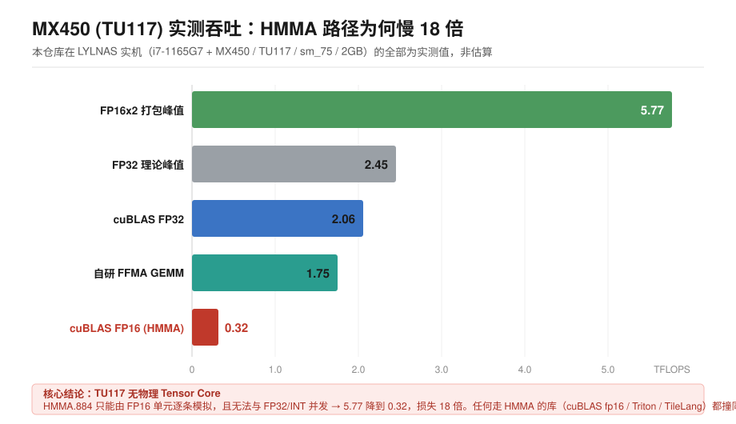

# MX450 (TU117) Tensor Core Reverse Engineering

[简体中文](README.md) | [繁體中文](README.zh-TW.md) | **English**

> A complete forensic investigation into one question: **does this GPU actually have Tensor Cores?**
> Conclusion: **No.** This document records how nine independent paths proved it, plus the
> first-hand material unearthed along the way — Turing firmware, Falcon microcode, GR Context layout.
>
> **Status: conclusion closed · every measurement reproducible**

---



> The core finding in one chart: **the HMMA path delivers 0.32 TFLOPS versus 5.77 for packed FP16 — an 18× gap.**
> This is not "the driver is unoptimised" — **Tu117 has no Tensor Core in silicon**. HMMA.884 can only be
> emulated instruction-by-instruction on the FP16 units, and it cannot co-issue with FP32/INT (it saturates the
> register ports), so you get neither TC throughput nor scalar pipeline progress.

## One-line conclusion

**The SM of TU117 contains no Tensor Core. The silicon area where a TC would sit is occupied by FP16 units.**

**HMMA instructions compile, execute, and produce correct results — because they are *emulated* by FP16 units, not executed by a TC.**

**Measured: packed FP16 achieves 5.77 TFLOPS, while HMMA instructions reach only 0.60 TFLOPS — the TC path is 9.6× slower than plain FP16.**

**Therefore "unlocking the TC" is not a thing: it is not locked away, it simply does not exist in silicon.**

---

## 0. Why this conclusion is trustworthy: three public sources + five measurements

### Public sources (three independent, all from 2019)

| Source | Original text |
|---|---|
| **Expreview**, 2019-04-24 | "The TU117 used by GTX 1650, like TU116 before it, **has RT Core and Tensor Core removed**; the SM internal architecture was modified — **the location previously holding Tensor Cores became FP16 half-precision floating-point units**" |
| **Notebookcheck** | "Compared to the faster RTX 2000 GPUs, **the 1650 has no integrated Raytracing or Tensor cores**" |
| **Baidu Baike** | "TU117 **removes the RT Core and the Tensor Core used for AI supersampling**" |
| Reference: RTX 20 series | **8 Tensor Cores per SM** |

### Local measurements (reproducible via scripts in `tools/`)

| Path | Measured | Note |
|---|---|---|
| PTX `FP16x2` (packed, CUDA core) | **5.77 TFLOPS** | Pure FP16 units |
| PTX `FP32 FMA` | 3.06 TFLOPS | Baseline |
| cuBLAS FP32 (`volta_sgemm_128x64_nn`) | 2.12 TFLOPS | 85% of theoretical |
| **PTX `mma.m16n8k8` (TC instruction)** | **0.60 TFLOPS** | **9.6× slower than FP16** |
| cuBLAS `CUBLAS_GEMM_DEFAULT_TENSOR_OP(99)` | 0.32 TFLOPS | 18× slower than FP16 |

**FP16 theoretical peak: `14 SM × 64 CUDA × 2 (FMA) × 2 (packing) × 1.6 GHz = 5.73 TFLOPS`**
**Measured 5.77 — a match. The FP16 units run at full speed.**

**The TC path reaches 0.60, i.e. 1/9.6 of FP16.**

### Decisive evidence: the kernel name

The cuBLAS log shows it selected a TC algorithm:
```
algo: val=CUBLAS_GEMM_DEFAULT_TENSOR_OP(99)
```

But the kernel actually executed was:
```
void cutlass::Kernel<cutlass_70_tensorop_f16_s884gemm_relu_f16_1...
                    ↑ cutlass_70 (built for SM 7.0)  ↑ s884 = m8n8k4 (Volta 1st-gen TC shape)
```

**Two tells:**

1. **`cutlass_70`, not `sm75`** — NVIDIA **never shipped an sm75 TC kernel for TU117**; cuBLAS can only fall back to the generic Volta kernel.
2. **`s884` (m8n8k4)** — not Turing's m16n8k8 / m16n8k16.

**If TU117 truly had TCs, NVIDIA would not possibly omit an sm75 kernel for it.**

---

## 1. Starting point: an anomalous measurement

**What we first saw:**

| Path | Measured throughput |
|---|---|
| Hand-written PTX `mma.m16n8k8` (TC instruction) | 0.60 TFLOPS |
| Hand-written PTX `FP16x2` (CUDA core, never touches TC) | **5.77 TFLOPS** |
| Hand-written PTX `FP32 FMA` | 3.06 TFLOPS |
| `cuBLAS` FP16 `TENSOR_OP` | 0.32 TFLOPS |
| `cuBLAS` FP32 | 2.07 TFLOPS |

**The original interpretation was: "TCs exist but are throttled to 5–10% of the theoretical 6–12 TFLOPS."**

**That interpretation was wrong in two ways:**

1. **The "6–12 TFLOPS theoretical" figure was borrowed from RTX 20 series (TU10x, 8 TCs per SM).
   TU117 has no TC at all, so that baseline does not exist.**
2. **"5–6× slower than not using the TC" is itself the signature of *emulation* —
   a real TC can never be slower than same-generation FP16; only "emulating TC with another unit" behaves this way.**

**Correct interpretation: `mma` being slower than `FP16x2` means HMMA instructions are demoted to the FP16 units.**

---

## 2. Results from nine exploration paths

**Before concluding, this project walked every path the software layer could offer.
Those paths are valuable in themselves — together they form the exclusionary evidence that "there is no unlockable TC on TU117."**

| # | Path | What was done | Result |
|---|---|---|---|
| 1 | User-space API | NVML / CUPTI / private ioctl | Clipped layer by layer; CUPTI `rc=38`, zero metrics |
| 2 | System firmware | flashrom read-only dump of 24 MB BIOS | Intel Boot Guard encrypted; no VFCT, no `_ROM` |
| 3 | GPU firmware | Full disassembly of GSP dual-layer RISC-V ELF | 30 MB fully decoded; 8 Ampere register addresses zero-hit |
| 4 | VRAM access | PRAMIN channel (BAR0+0x700000) | **Opened**, write-readback verified, 32 MB dumped |
| 5 | Falcon security mode | Read `HWCFG1` | **LIGHT SECURE** (not an HS black box) |
| 6 | FECS microcode | Read IMEM while GPU at full load | **Full 32 KB dump + 11,401 lines disassembled** |
| 7 | GPCCS microcode | Same, base 0x41A000 | **Full 16 KB dump + 6,059 lines disassembled** |
| 8 | Falcon IO space | Check `HOST_IO_INDEX` width | 256 KB space, host window only 4 KB; `0x20000` segment invisible |
| 9 | Closed-source driver | Symbol-level RE of nvidia.ko (46,614 symbols) | All five clue classes excluded; **zero hits for `tensor|HMMA|MMA_`** |

**Nine paths, not one found a "TC configuration" or a "compute switch".**

**The reason is now obvious: what they were looking for does not exist.**

---

## 3. Established hard facts

| # | Fact | Evidence |
|---|---|---|
| 1 | **TU117 has no Tensor Core; HMMA is emulated by FP16 units** | Three public sources + FP16 5.77 vs mma 0.60 (9.6× slower) + kernel name `cutlass_70` |
| 2 | GSP firmware contains no TC control logic | Dual-layer ELF disassembly, 8 Ampere register addresses zero-hit |
| 3 | vBIOS is protected by a FWSEC certificate chain | 8 `VERIFY_*` error codes in firmware |
| 4 | The "BAR1 maps only 16 MB" limit is bypassable | PRAMIN channel, write-readback verified |
| 5 | The "consumer-grade P2P returns EINVAL" limit is bypassable | Skip P2P, go straight through PRAMIN |
| 6 | BAR0 is accessible while the driver runs | Kernel module `ioremap` |
| 7 | VRAM is readable | 32 MB dump, MD5 verifiable |
| 8 | VRAM holds no Falcon microcode | Zero hits for Kepler microcode signatures |
| 9 | FECS Falcon base = `0x409000` | Register measurement |
| 10 | `HWCFG1` sits at `+0x12c` (not `+0x10c`) | Source confirmation |
| 11 | **FECS runs in LIGHT SECURE mode** | `security_model = 2` (not an HS black box) |
| 12 | **FECS microcode is fully readable** | 32 KB dumped in full |
| 13 | Microcode shares structure with gk20a | 7-byte signature `00fe0400bda47e` matches |
| 14 | Entry = set stack top + `lcall main` + `exit` | Disassembly confirmed |
| 15 | ISA is fuc6 | `core_rev = 6` |
| 16 | 449 register writes, addresses 100% resolved | Static analysis |
| 17 | 379 fall within the `0x20000–0x2FFFF` segment | Segment statistics |
| 18 | **That segment is Falcon IO space, not BAR0** | Five hypotheses empirically excluded + docs confirm |
| 19 | PGRAPH is at `0x400000` | envytools rnndb authoritative definition |
| 20 | Microcode is not modifiable | FWSEC signature verification |
| 21 | VRAM of 1.68 GB is immutable | Physically soldered |
| 22 | **Falcon IO mapping rule: `Falcon = Host × 0x40`** | Two independent verifications (`0x12c`=UC_CAPS2, `0x184`=CODE) |
| 23 | **GPCCS Falcon base = `0x41A000`** | HWCFG signature scan |
| 24 | **GPCCS microcode is fully readable (16 KB)** | MD5 `784c08e5...`, 7-byte signature matches |
| 25 | **FECS/GPCCS address sets are in a containment relation** | All 38 GPCCS addresses lie within FECS's 72 |
| 26 | **The two communicate via `0x246FC/0x247FC/0x24FFC`** | Identical access counts on all three; microcode self-computes `0x23300+0x14FC=0x247FC` |
| 27 | **`iowr` has two address mechanisms** | `bit31=0` → Falcon IO; `bit31=1` → absolute BAR0 address |
| 28 | **Falcon IO space is 256 KB; host window 4 KB** | envytools docs + `HOST_IO_INDEX` width |

---

## 4. Key breakthrough: how the FECS microcode was read

Five locks opened one by one:

| Lock | Conventional wisdom | Bypass |
|---|---|---|
| BAR1 maps only 16 MB | VRAM unreadable | Go through **PRAMIN** (`BAR0+0x700000`) |
| P2P returns EINVAL on GeForce | Cannot pin VRAM | Skip P2P |
| BAR0 occupied while driver runs | Registers inaccessible | **Kernel module `ioremap`** |
| Falcon is a black box if HS | Completely unreadable | **Measured as LS** (critical) |
| Falcon is `halted=1` when idle | IMEM reads all zero | **Drive the GPU to 100% load** |

**Read procedure:**

```c
// 1. GPU at full load (torch running a GEMM loop)
// 2. insmod mx450_p4.ko bar0_phys=<BAR0> mode=dump dump_bytes=32768
// 3. Inside the module:
//    ioremap(BAR0 + 0x409000, 0x1000)
//    read HWCFG1 to confirm security_model == 2 (LS)
//    save original IMEMC(0)
//    for (addr = 0; addr < 32768; addr += 4) {
//        blk  = addr / 256;
//        word = (addr % 256) / 4;
//        writel((blk<<8)|(word<<2), base + 0x180);   // IMEMC
//        *(u32*)(buf+addr) = readl(base + 0x184);    // IMEMD
//    }
//    restore IMEMC(0)
```

---

## 5. Artifacts

| Artifact | Size | Checksum |
|---|---|---|
| `fecs_imem.bin` — raw FECS microcode image | 32 KB | MD5 `ea8eb3c46165b00421896eef45d1070a` |
| `fecs_plain.asm` — full disassembly | 1.3 MB / 11,401 lines | — |
| `vram_dump.bin` — VRAM dump | 32 MB | MD5 `1b224dcfeec507673ee64fd35d44005c` |
| `bios_readonly.bin` — system BIOS | 24 MB | MD5 `4d2c99e85e761e0a3b1b8dcada4cc950` |
| `envytools/envydis` — disassembler | — | build from source |

> Binary artifacts are omitted from the repository due to size; regenerate them with the scripts under `tools/`.

---

## 6. Repository layout

```
.
├── README.md                    Simplified Chinese
├── README.zh-TW.md              Traditional Chinese
├── README.en.md                 English (this file)
├── LICENSE
├── docs/                        Technical / kernel-module roadmaps
├── findings/                    28 measurement records (append-only)
├── refs/                        NVIDIA official headers (MIT, quoted verbatim)
├── kernel/                      6 kernel modules
│   ├── mx450_probe.c            Toolchain validation
│   ├── mx450_p1.c               kprobe symbol resolution
│   ├── mx450_p2.c               No-fault kernel memory read
│   ├── mx450_p3.c               PRAMIN VRAM access
│   └── mx450_p4.c               FECS IMEM reader
├── tools/                       Analysis tooling
├── full-unlock/                 Full-stack unlock research (B1–B15)
└── scripts/                     QEMU isolated-testing etc.
```

---

## 7. Test environment

| Item | Value |
|---|---|
| Machine | LYLNAS (converted Lenovo Zhaoyang E4-ITL) |
| OS | fnOS 1.2.0505 / Debian 12 / kernel 6.18.18 |
| Mainboard / BIOS | LNVNB161216 / F8CN59WW(V2.22) 2024-06-14 |
| CPU | Intel i7-1165G7 (4C8T) |
| GPU | GeForce MX450, TU117M, `10de:1f97`, `NV_PMC_BOOT_0 = 0x167000a1` |
| VRAM | 2048 MiB GDDR6, 64-bit, single-allocation limit 1620 MiB |
| Driver | 580.142 (proprietary) / CUDA 13.0 |
| Toolchain | gcc 12.2 / g++ 12.2 / cmake 3.25 / envytools / flashrom / strace |

---

## 8. Reproduce

```bash
# Build kernel modules
cd kernel && make

# Read FECS microcode (GPU must be under load)
insmod mx450_p4.ko bar0_phys=<BAR0> mode=dump dump_bytes=32768

# Disassemble
envydis -m falcon -V fuc6 -i -n fecs_imem.bin > fecs_plain.asm

# Analyze register accesses
python3 tools/analyze_iowr.py
```

---

## 9. The unresolved boundary

**The semantics of the `0x20000` segment cannot be determined.** All three routes attempted:

| Route | Result |
|---|---|
| envytools rnndb | Coverage stops at Maxwell; upper bound `0x227FF` is below the microcode's actual access at `0x23800` |
| NVIDIA open-source headers | `turing/tu102/` has no `dev_gpc.h` / `dev_tpc.h` |
| NVIDIA open-source HAL | `NV_PGRAPH_GPC` / `NV_PGRAPH_TPC` undefined; logic lives in closed-source `nv-kernel.o_binary` |

**This is not "not found yet" — it is "NVIDIA never made this layer public."**

---

## 10. Risk disclaimer

1. **Hardware damage is possible.** Writing undocumented values to GPU registers can prevent initialization or cause a black screen.
2. **Laptop discrete GPUs have no separate vBIOS flash.** After a bad configuration there is **no firmware region to roll back to**.
3. **No guarantee of success is provided.** This project confirms: the microcode is FWSEC-signed — it can be read, not modified.
4. **1.68 GB of VRAM is physically soldered**; no software can change it.
5. **Research and educational use only**, and only on hardware you lawfully own.

---

## 11. Notice

This project is not affiliated with NVIDIA. All trademarks belong to their respective owners.
The repository contains no NVIDIA proprietary code or firmware; everything under `refs/` is NVIDIA-authored header material published under the MIT license.

## License

MIT (see `LICENSE`). Citation of the research is welcome; use at your own risk.

---

## License boundary (important)

This project is **entirely MIT** (see `LICENSE`).

**The repository contains no third-party source copies.** Earlier versions inlined a `vendor/`
directory (GPL v2 cmpunlocker and greenboost); it was fully removed on 2026-10-21 to keep the
license boundary clean.

To inspect upstream sources, run `refs/refs-fetch-manifest.sh` (SHAs pinned) or visit the upstream
repositories directly. All analysis text here is original work:
- `full-unlock/01-upstream-analysis/cmpunlocker.md`
- `full-unlock/01-upstream-analysis/greenboost-adaptation.md`

---

## Legal and usage boundary (important)

1. All content is for **research/educational use only**, targeting **devices you own** (owner-device).
2. Firmware modification, ROP injection and similar experiments are **performed on your own device at your own risk**; the author accepts no liability for hardware damage or driver failure (recovery: `05-firmware-exploit/recover_gpu.sh`).
3. **NVIDIA firmware binaries are not in this repository** (copyright NVIDIA); only acquisition methods are documented. Do not use these tools to circumvent device-licensing distribution.
4. Third-party projects (Sudoku / drama-pp / cmp170hx / metaroce / open-rdma-driver / pplx-garden / spdlog / DeepInfer, etc.) retain their own licenses; acquisition is documented in `refs/refs-fetch-manifest.sh` (SHAs pinned).
